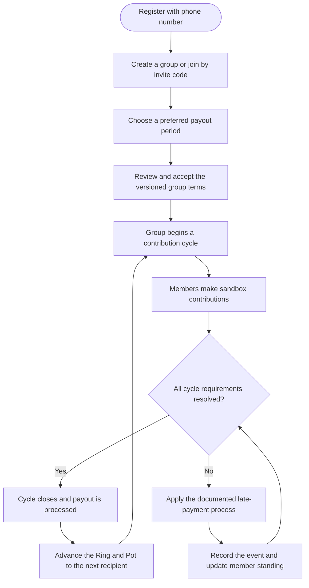
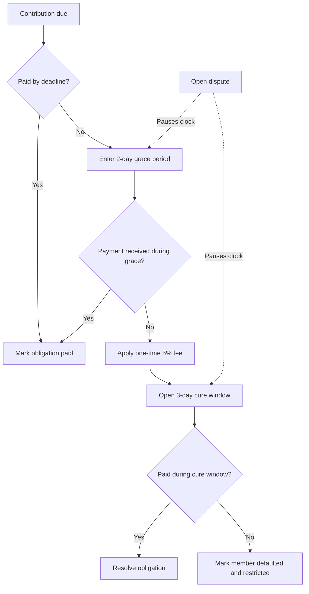
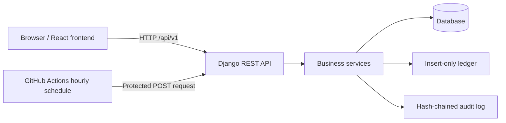

<div align="center">
<p align="center">


**A student-led digital platform for organizing and managing Ethiopian Equb groups.**

[](https://github.com/c4realm/abeba)


</div>

---

> **Abeba** (አበባ) means *flower*. Each member is a petal; the shared pot is the heart of the flower.
>
> Formerly named **Digital Equb System**.

Abeba Equb is a mobile-first web application that brings the Ethiopian **Equb** — a rotating savings group — into a structured digital environment. It is being built by students, for the younger generation, and is open to adults who want to participate.

The project focuses on making group contributions, payment deadlines, payout order, and member responsibilities easier to understand and track. It also addresses a central challenge in rotating savings groups: balancing the risk between members who receive the pot early and those who receive it later.

<sub>Project status: active development · November 10–December 14, 2026</sub>

<sub>⚠️ **Academic prototype:** all payments are simulated. No real money is held, moved, or transmitted. See the <a href="#disclaimer">disclaimer</a>.</sub>

---

## Contents

- [At a glance](#at-a-glance)
- [Why Abeba?](#why-abeba)
- [How it works](#how-it-works)
- [Payout model](#payout-model)
- [Late-payment rules](#late-payment-rules)
- [Feature status](#feature-status)
- [System architecture](#system-architecture)
- [Technology stack](#technology-stack)
- [Repository structure](#repository-structure)
- [Getting started](#getting-started)
- [Configuration](#configuration)
- [Quality and security](#quality-and-security)
- [Visual identity — The Woven Circle](#visual-identity--the-woven-circle)
- [Project roadmap](#project-roadmap)
- [Development workflow](#development-workflow)
- [Documentation](#documentation)
- [Team](#team)
- [Disclaimer](#disclaimer)
- [License](#license)

---

## At a glance

| | |
|---|---|
| **Project** | Abeba Equb |
| **Purpose** | Digital management of Ethiopian rotating savings groups |
| **Primary audience** | University students and other community members |
| **Backend** | Python, Django 5.2, Django REST Framework |
| **Database** | SQLite for local development; PostgreSQL planned for deployment |
| **Frontend** | React-based application planned |
| **Payment handling** | Sandbox simulation only |
| **Current stage** | Business-rule engine implemented; user-facing application under development |

### What Abeba is designed to provide

- Phone-number registration and account access.
- Equb group creation and invitation.
- Shared, versioned group terms.
- Contribution obligations and cycle tracking.
- A transparent payout order with early, middle, and late tiers.
- Consistent late-payment handling.
- An insert-only financial ledger and hash-chained audit history.
- A visual **Ring and Pot** concept representing members and the shared pot.

---

## Why Abeba?

An Equb depends on trust. As a group grows, managing contributions and deadlines through notebooks or chat messages can make records difficult to verify. Disagreements can arise when members have different understandings of payment rules, penalties, or payout order.

Abeba is designed to make those rules visible and consistently applied.

| Common challenge | Abeba's approach |
|---|---|
| Records are kept in notebooks or chat groups and may be lost or disputed. | Contributions and financial events are designed to be recorded in a tamper-evident history. |
| Payment reminders and deadlines are informal. | Deadlines and payment states follow defined rules. |
| Penalties may be applied inconsistently. | A documented late-payment sequence defines the grace period, fee, cure window, and default state. |
| Early recipients and late recipients carry different risks. | Payout tiers, holdbacks, and an early premium are designed to address that imbalance. |
| Some students have limited access to formal savings products. | The prototype is designed around accessible group participation and phone-number sign-in. |

**The central design question:** how can an Equb distribute its pot in turns while making the responsibilities and risks of receiving early or waiting until later understandable to every member?

---

## How it works

The intended member journey is:



1. **Register:** a member creates an account using a phone number.
2. **Create or join:** an organizer creates a group, or a member joins using a private invitation code.
3. **Choose a payout preference:** members indicate whether they prefer an early, middle, or late payout position.
4. **Accept the terms:** every member accepts the same version of the group's rules before the group starts.
5. **Contribute:** members make their contributions for each cycle through the sandbox payment flow.
6. **Close the cycle:** the cycle is closed and the designated member receives the simulated payout.
7. **Record and continue:** the system records relevant events and advances to the next cycle.

The complete business rules are documented in [`docs/CHARTER.md`](docs/CHARTER.md).

---

## Payout model

Abeba uses three payout tiers to represent the different positions members can occupy in a rotating savings group.

For a group with **N members**:

- The first 30% of slots are classified as **early**.
- The last 30% of slots are classified as **late**.
- The remaining slots are classified as **middle**.

### Holdback

An early recipient receives part of the payout immediately. A portion is held back and released after the recipient makes each of their later on-time contributions.

| Payout tier | Holdback rate |
|---|---:|
| Early | 30% |
| Middle | 10% |
| Late | 0% |

The holdback calculation is:

```text
holdback = rate × contribution × (members - slot)
```

### Early premium

An early recipient pays a **2% premium of the pot**. The premium is intended to be shared among late-tier members who finish the group without an unresolved default. It is designed to recognize the additional waiting period carried by late recipients.

### Worked example

Assume a group has 10 members, each contributing 1,000 Br. The member in slot 1 is an early recipient.

| Item | Amount |
|---|---:|
| Total pot | 10,000 Br |
| Early premium (2%) | −200 Br |
| Holdback (30% × 1,000 × 9) | −2,700 Br |
| **Amount paid immediately** | **7,100 Br** |
| Released after each later on-time payment | 300 Br |

This example explains the current project rule model. It does not represent a real transaction or a promise of financial return.

---

## Late-payment rules

The late-payment process is designed to be predictable and consistently applied.

The contribution deadline is **23:59 Addis Ababa time** on the due date.



| Stage | Rule |
|---|---|
| Before the deadline | Reminders are planned. |
| Grace period | Two days with no late fee. |
| After the grace period | A one-time 5% fee is applied, subject to a maximum of 10% and never compounded. |
| Cure window | The member has three days to pay after the grace period. |
| Open dispute | The payment clock is paused while the dispute is open. |
| Cure window expires | The member is marked as defaulted and their standing becomes restricted. They can still pay. |

### Financial records and auditability

The project uses two important record-keeping concepts:

- **Insert-only ledger:** existing financial entries are not edited or deleted. Corrections are represented by visible reversing entries.
- **Hash-chained audit log:** each audit event is linked to the previous event through a hash. Changing or deleting an earlier event breaks the chain and can be detected by an integrity check.

These mechanisms are intended to make the history of financial and administrative events easier to inspect.

---

## Feature status

The project is under active development. The table below distinguishes implemented work from work that is still in progress or planned.

| Area | Current status |
|---|---|
| Payout tiers, holdback, and premium calculations | <span>Built and tested</span> |
| Late-payment ladder and boundary cases | Built and tested |
| Insert-only ledger with idempotent writes | Built and tested |
| Hash-chained audit log and integrity check | Built and tested |
| Hourly deadline job, safe to run more than once | Built and tested |
| Phone registration and login (bcrypt, JWT, rate limiting) | Built and tested |
| Demo time travel for staging | Built |
| Groups, joining, terms acceptance, cycles, and obligations API | In progress |
| Sandbox payments, cycle close, and payout | Planned |
| React authentication, create/join flows, and payment sheet | Planned |
| Ring and Pot connected to live application data | Planned |
| Group detail, organizer view, demo seed data, staging deployment | Planned |
| Disputes, hardship extension, notices, and admin console | Planned |
| Amharic interface and Ethiopian calendar support | Planned |
| Guarantor, lottery order, student registry, email delivery | Stretch goals |

For the latest development progress, see [`timeline.html`](timeline.html) and the repository's [GitHub issues](https://github.com/c4realm/abeba/issues).

---

## System architecture

The backend separates HTTP request handling from the business rules. The service layer contains the core rules so they can be tested independently of individual API views.



### Main backend responsibilities

| Component | Responsibility |
|---|---|
| `accounts` | User model, phone registration, and login |
| `groups` | Groups, group terms, and memberships |
| `cycles` | Contribution cycles and payment obligations |
| `money` | Ledger entries and payouts |
| `audit` | Audit events and hash-chain integrity |
| `services` | Payout calculations, late-payment rules, ledger operations, audit operations, and deadline processing |
| `core` | Shared infrastructure, demo clock, health endpoint, and scheduled-job endpoint |

### Why use a service layer?

Business rules are implemented as Python functions that do not depend directly on HTTP requests. This makes the rules easier to test and helps prevent an API endpoint from bypassing the intended calculations or validation.

### Why use an external scheduled job?

Some free hosting environments can sleep when idle, making a continuously running background worker unreliable. The project therefore uses an hourly GitHub Actions workflow to call a protected deadline-processing endpoint. The deadline logic calculates obligation states from their dates, and the job is designed to be safe to run more than once.

---

## Technology stack

| Layer | Technology | Role |
|---|---|---|
| Backend language | Python | Application and business-rule implementation |
| Backend framework | Django 5.2 | Core web application |
| API | Django REST Framework | HTTP API |
| Authentication | SimpleJWT, bcrypt | Token-based authentication and password hashing |
| Local database | SQLite | Quick local development |
| Planned deployment database | PostgreSQL (Neon) | Persistent hosted database |
| Planned frontend | React, Vite | User-facing web application |
| Planned styling | Tailwind CSS | Frontend styling |
| Planned routing and data | React Router, TanStack Query | Navigation and server-state management |
| Planned 3D visualization | Three.js | Ring and Pot visualization |
| Planned localization | react-i18next | Interface translation support |
| Testing and quality | pytest, Ruff, Bandit, pip-audit, Gitleaks | Tests, linting, security checks, dependency auditing, and secret scanning |
| Automation | GitHub Actions | CI and scheduled deadline processing |
| Planned hosting | Vercel, Render | Frontend and backend hosting |

Some frontend and deployment technologies are part of the planned implementation and should not be interpreted as already deployed features.

---

## Repository structure

```text
abeba/
├── backend/
│   ├── config/                 # Django settings, URLs, test settings
│   ├── apps/
│   │   ├── accounts/           # User model, registration, login
│   │   ├── groups/             # Group, GroupTerms, Membership
│   │   ├── cycles/             # Cycle, Obligation
│   │   ├── money/              # LedgerEntry, Payout
│   │   ├── audit/              # AuditEvent and hash chain
│   │   └── core/               # Shared infrastructure, demo clock, endpoints
│   ├── services/               # Tiers, payout, ladder, ledger, audit, deadlines
│   └── tests/                  # Business-rule and backend tests
├── frontend/                   # Frontend application and design tokens
├── docs/
│   ├── CHARTER.md              # Business rules
│   ├── CODE_GUIDE.md           # Code explanations and key concepts
│   ├── DECISIONS.md            # Technical decision log
│   ├── AGENT_LOG.md            # AI-assisted development record
│   └── prototypes/
│       └── ring-and-pot.html   # 3D Ring and Pot prototype
├── scripts/
│   ├── check.sh                # Local quality and security checks
│   ├── setup_github.sh         # GitHub setup helper
│   └── tasks.json              # Project task definitions
├── .github/                    # CI, scheduled workflow, issue templates
├── AGENTS.md                   # Guidelines for AI coding agents
├── CONTRIBUTING.md             # Contribution workflow
└── timeline.html               # Project timeline
```

---

## Getting started

### Prerequisites

- Python 3.12 or newer
- Git
- Node.js 20 or newer (for the frontend when its application scaffold is available)
- Optional: Gitleaks for secret scanning

### 1. Clone the repository

```bash
git clone https://github.com/c4realm/abeba.git
cd abeba
```

### 2. Create and activate a Python virtual environment

```bash
cd backend
python3 -m venv .venv
source .venv/bin/activate
```

### 3. Install backend dependencies

```bash
pip install -r requirements.txt ruff bandit pip-audit
```

### 4. Configure the environment

```bash
cp .env.example .env
```

For a quick local run using SQLite, remove or leave unset the `DATABASE_URL` line in `.env`, as appropriate for the local configuration.

### 5. Run database migrations

```bash
python manage.py migrate
python manage.py createcachetable
```

### 6. Start the development server

```bash
python manage.py runserver
```

The backend should be available at:

```text
http://127.0.0.1:8000/
```

### 7. Check the health endpoint

In another terminal:

```bash
curl http://127.0.0.1:8000/api/v1/health/
```

Expected response:

```json
{"status": "ok"}
```

### Register and log in

Phone numbers use the `+251 9xx` or `+251 7xx` format. Passwords must be at least 10 characters.

**Register:**

```bash
curl -X POST http://127.0.0.1:8000/api/v1/auth/register/ \
  -H 'Content-Type: application/json' \
  -d '{"phone":"+251911223344","full_name":"Abebe Kebede","password":"Str0ng-pass-1234"}'
```

**Log in:**

```bash
curl -X POST http://127.0.0.1:8000/api/v1/auth/login/ \
  -H 'Content-Type: application/json' \
  -d '{"phone":"+251911223344","password":"Str0ng-pass-1234"}'
```

Use a test phone number and a unique development password. Do not use real credentials in examples, documentation, commits, or screenshots.

---

## Configuration

The backend reads environment variables for runtime configuration.

| Variable | Purpose |
|---|---|
| `ENVIRONMENT` | Runtime environment: `dev`, `staging`, or `production`. |
| `DEBUG` | Enables debug behavior in development only. |
| `DEMO_MODE` | Enables demo time travel. Never enable this in production. |
| `SECRET_KEY` | Django secret key. Required outside development; never commit it. |
| `DATABASE_URL` | PostgreSQL connection string. Leave unset for local SQLite configuration. |
| `ALLOWED_HOSTS` | Comma-separated list of permitted hostnames. |
| `CRON_TOKEN` | Secret used to protect the scheduled deadline endpoint. |

Never commit `.env` files, passwords, API tokens, signing keys, or other secrets.

---

## Run the project checks

From the repository root:

```bash
./scripts/check.sh
```

The check script runs the project's configured quality and security checks, including:

- Ruff
- pytest
- Bandit
- pip-audit
- Gitleaks

A successful run should finish with:

```text
ALL CHECKS PASSED
```

Run the checks before committing changes. CI is also configured to run checks on pull requests.

---

## Demo: time travel

The backend includes a command-line tool for moving the application clock forward during development or staging. It can help demonstrate multi-day payment and penalty scenarios without waiting several real days.

Move the demo clock forward by four days:

```bash
DEMO_MODE=1 python manage.py simulate_time --days 4
```

Reset the demo clock:

```bash
DEMO_MODE=1 python manage.py simulate_time --reset
```

**Important:** this is a development/staging demonstration feature. It is a command-line tool, not a public web endpoint, and must never be enabled in production.

---

## Quality and security

Security is considered part of the system design, particularly because the application models financial obligations and member records.

### Implemented controls

The current backend includes:

- Password hashing with bcrypt.
- Short-lived access tokens.
- Registration and login rate limiting with a shared store.
- Server-side handling of account roles and standing; registration ignores client-supplied `role` or `standing` values.
- Insert-only ledger and audit tables.
- Decimal-based money values rather than floating-point arithmetic.
- Idempotency keys to help prevent duplicate processing when a request is retried.
- A protected scheduled-job endpoint that uses POST, a secret token, and constant-time token comparison.
- Production startup checks that reject unsafe debug or demo-mode configurations.
- A capped request-body size.
- Automated tests and security-oriented checks.

### Planned security work

The following items are planned and should not be considered complete until implemented and tested:

- Refresh tokens in HttpOnly cookies.
- Password reset using single-use tokens.
- Per-account and per-IP login throttling.
- Object-level permission checks across API endpoints.
- Tests attempting to access another user's data.
- Publishing the latest audit-chain hash outside the database.
- A dedicated security-event log.
- A penetration-testing pass covering access control, race conditions, money logic, sessions, headers, injection, and information disclosure.

### Security checks in development

The `scripts/check.sh` workflow and GitHub Actions CI are intended to provide repeatable checks for code quality, tests, common security issues, dependency vulnerabilities, and accidentally committed secrets.

Passing automated checks does not prove that an application is secure. The project still requires manual review and security testing before any real-world deployment.

---

## Visual identity — The Woven Circle

Abeba's visual direction takes inspiration from two references:

1. The circular woven structure of a traditional Ethiopian **mesob**.
2. Modern Ethiopian patchwork art, including flat color panels and floral details.

The design concept connects the idea of a shared savings circle with the image of a flower: members form the petals around the central pot.

### Color palette

| Design token | Hex value | Intended use |
|---|---|---|
| Cream fiber | `#F4ECD8` | Page background |
| Plum ink | `#1F1A1F` | Main text |
| Crimson weave | `#B5192B` | Overdue and danger states |
| Emerald weave | `#1F8A57` | Paid and confirmed states |
| Indigo weave | `#2B2379` | Primary actions |
| Ochre panel | `#E4A81E` | Money and highlights |
| Terracotta | `#C9603E` | Warm panels |
| Scarf lilac | `#7B6FC4` | Secondary panels |
| Straw | `#D5AA76` | Weave texture |

### The Ring and Pot

The **Ring and Pot** is the project's signature visualization concept:

- Members are represented as points arranged around a circular ring.
- A woven pot sits at the center.
- The pot represents the shared contribution pool.
- The ring represents the members and their payout order.
- Closing a cycle advances the ring to the next recipient.

A Three.js/WebGL prototype demonstrates this visual concept. It also uses a programmatically generated woven texture and CSS styling.

The prototype is available at [`docs/prototypes/ring-and-pot.html`](docs/prototypes/ring-and-pot.html). Open the file in a browser to explore it.

The design tokens are maintained in [`frontend/src/styles/tokens.css`](frontend/src/styles/tokens.css).

**Implementation note:** this section describes the design direction and the existing prototype. It does not claim that every planned visual element is already implemented in the production-facing frontend, or that all project graphics are hand-built SVGs. Asset and library sources should be documented accurately as the interface develops.

### Design principles

- **Mobile-first:** layouts are designed with small screens, starting at 360 px, in mind.
- **Accessible status communication:** color should be accompanied by an icon and text label.
- **Contrast:** the design targets WCAG AA contrast.
- **Reduced motion:** animation should communicate meaningful state changes and respect reduced-motion preferences.
- **Localization:** English is the initial interface language, with Amharic and Ethiopian calendar support planned.

---

## Project roadmap

The current development plan runs from **November 10 to December 14, 2026**, with a code freeze planned for December 12 and submission planned for December 15.

| Week | Dates | Main goals |
|---|---|---|
| Week 1 | Nov 10–16 | Repository and CI, UX structure, groups and join API, React scaffold, shared components |
| Week 2 | Nov 17–23 | Sandbox payments, cycle close and payout, authentication screens, create/join flows, 3D Ring and Pot |
| Week 3 | Nov 24–30 | Late-payment flow, group detail, organizer view, demo data, staging deployment |
| Week 4 | Dec 1–7 | Disputes, notices, admin console, Amharic, polish, security tests, usability test |
| Week 5 | Dec 8–14 | Bug fixes, documentation, demo rehearsal, code freeze |

For live progress, open [`timeline.html`](timeline.html) or visit the [GitHub issues](https://github.com/c4realm/abeba/issues).

---

## Development workflow

The project follows a branch-based workflow.

### Branches

Create one branch per GitHub issue. Use names such as:

```text
feat/<issue>-short-name
fix/<issue>-short-name
```

Do not commit directly to `main`.

### Commit messages

Use a short prefix describing the change:

```text
feat: add group invitation endpoint
fix: prevent duplicate ledger entries
test: cover late-payment boundary
docs: update setup instructions
chore: configure development tooling
```

### Pull requests

- Open a pull request for each change.
- Ensure CI passes.
- Request a teammate review before merging.
- Add or update tests when behavior changes.
- Update relevant documentation and development logs.

See [`CONTRIBUTING.md`](CONTRIBUTING.md) for the contribution workflow.

### Definition of done

A change is considered complete when it has been reviewed and merged, the project checks pass, relevant tests are included, the behavior has been demonstrated, and the development log is updated.

### AI-assisted development disclosure

AI assistants are used to support parts of the development process, including code generation and review. The project rules for AI coding agents are documented in [`AGENTS.md`](AGENTS.md), and AI-assisted sessions are recorded in [`docs/AGENT_LOG.md`](docs/AGENT_LOG.md).

The team remains responsible for reviewing changes, running checks, validating behavior, and deciding what is included in the project.

---

## Documentation

| Document | Description |
|---|---|
| [`docs/CHARTER.md`](docs/CHARTER.md) | Business rules and Equb operating principles |
| [`docs/CODE_GUIDE.md`](docs/CODE_GUIDE.md) | Code explanations, key concepts, and likely questions |
| [`docs/DECISIONS.md`](docs/DECISIONS.md) | Technical and project decision log |
| [`docs/AGENT_LOG.md`](docs/AGENT_LOG.md) | Record of AI-assisted development sessions |
| [`docs/VSCODIUM_SETUP.md`](docs/VSCODIUM_SETUP.md) | Editor and agent setup |
| [`docs/prototypes/ring-and-pot.html`](docs/prototypes/ring-and-pot.html) | Interactive 3D visualization prototype |
| [`AGENTS.md`](AGENTS.md) | Instructions for AI coding agents |
| [`CONTRIBUTING.md`](CONTRIBUTING.md) | Contribution guidelines |
| [`timeline.html`](timeline.html) | Project timeline and progress |

---

## Team

**Senior project**  
St. Mary's University · Department of Computer Science  
Sections B and C · Academic Year 2025–2026  
Addis Ababa, Ethiopia

| Team member |
|---|
| Amar Abdulmejid |
| Kaleab Dejene |
| Kidus Kibrom |
| Yonas Ajanew |

**Project advisor:** Mr. Eshetu Tadesse

---

## Disclaimer

Abeba Equb is an **academic prototype**.

All payments in this project are simulated. No real money is held, moved, or transmitted. The application is not a bank, a licensed payment service, or a source of financial advice.

Any real-world deployment involving actual funds would require legal review and the appropriate financial licensing and regulatory approvals in Ethiopia before handling payments.

---

## License

A license has not yet been selected. Until the project includes a `LICENSE` file, all rights are reserved by the authors.

If the team intends to permit reuse, modification, or redistribution, it should discuss and select an appropriate open-source license before adding one.

---

<div align="center">

**Save together, bloom together.**

### አበባ · Abeba Equb

<sub>Built with care in Addis Ababa, Ethiopia.</sub>

</div>
