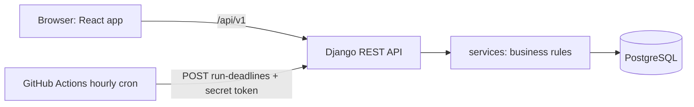

# አበባ · Abeba Equb

### *Save together, bloom together.*

Abeba Equb is a mobile-first web application that brings the Ethiopian **Equb** (a rotating savings group) online. It is built **by students, for the young generation**, and open to adults who want to take part. It records every contribution, applies late-payment rules fairly and automatically, and protects members from the risk that matters most in any Equb: who gets the money first, and who has to wait.

> *Abeba* (አበባ) means "flower". Every member is a petal; the pot is the heart of the flower.
> Formerly named *Digital Equb System*.

**Status:** under active development (Nov 10 to Dec 14, 2026). The business-rule engine is built and tested; the user-facing app is being built now. See [Feature status](#feature-status).

**Important:** all payments in this project are a **sandbox simulation**. No real money moves. See [Disclaimer](#disclaimer).

---

## Table of contents
1. [Why Abeba Equb](#why-abeba-equb)
2. [How it works](#how-it-works)
3. [The rules in plain language](#the-rules-in-plain-language)
4. [Feature status](#feature-status)
5. [Architecture](#architecture)
6. [Tech stack](#tech-stack)
7. [Repository structure](#repository-structure)
8. [Getting started](#getting-started)
9. [Quality and security](#quality-and-security)
10. [Design: the Woven Circle](#design-the-woven-circle)
11. [Project plan](#project-plan)
12. [How we work](#how-we-work)
13. [Documentation index](#documentation-index)
14. [Disclaimer](#disclaimer)
15. [Team](#team)
16. [License](#license)

---

## Why Abeba Equb

An Equb works because people trust each other. It struggles when the group grows, when records are kept on paper or in chat messages, or when someone stops paying and nobody has an agreed way to respond. University students feel this most: they have small, irregular incomes and often no formal bank account, yet they are the people who gain most from saving together.

| Problem in a traditional Equb | What Abeba Equb does |
| --- | --- |
| Records live in a notebook or a chat group and can be lost or disputed | Every payment and decision is written to a permanent, tamper-evident record |
| Reminders are informal and uneven | Deadlines and reminders follow the same rules for everyone |
| Penalties depend on who knows whom | A fixed, visible ladder: grace period, one fee, a cure window, then default |
| The member paid first can disappear; the member paid last carries the risk | **Payout tiers** (early, middle, late), a **holdback** on early payouts, and a premium that rewards the members who wait |
| Students are shut out of formal savings products | Student-led, phone-number sign-in, small contributions, no bank account needed for the prototype |

**What makes this project different:** it is youth-oriented and student-led, adults are welcome to join, and it treats the first/middle/last payout problem as the central design question instead of an afterthought.

---

## How it works

1. **Register** with a phone number.
2. **Create a group** (organizer): choose the contribution amount, how often, and how many members.
3. **Invite friends** with a private invite code. Members choose when they would like to be paid: early, middle or late.
4. **Accept the terms.** The rules are frozen into a versioned document and every member accepts the exact same version before the group starts.
5. **Each cycle, everyone pays** their contribution (sandbox payment). The pot fills.
6. **The cycle closes** and one member receives the pot, in turn. The 3D "Ring and Pot" turns to the next member.
7. **If someone is late**, the penalty ladder plays out step by step with clear notice. Everything is recorded and can be checked later.

---

## The rules in plain language

The full rules are in [`docs/CHARTER.md`](docs/CHARTER.md). In short:

**Payout tiers.** For a group of N members, the first 30% of slots are *early*, the last 30% are *late*, the rest are *middle*.

**Holdback.** A member paid early receives a smaller amount up front. The rest is held and released after each of their later on-time payments.

| Tier | Holdback rate |
| --- | --- |
| Early | 30% |
| Middle | 10% |
| Late | 0% |

`holdback = rate x contribution x (members - slot)`

**Early premium.** An early recipient pays 2% of the pot. It is meant to be shared among late-tier members who finish with no unresolved default, as a thank-you for waiting.

**Worked example.** 10 members, 1,000 Br each, member in slot 1 (early):

| Item | Amount (Br) |
| --- | --- |
| Pot | 10,000 |
| Premium (2%) | -200 |
| Holdback (30% x 1,000 x 9) | -2,700 |
| **Paid now** | **7,100** |
| Released after each later on-time payment | 300 |

**Late-payment ladder.** The deadline is 23:59 Addis Ababa time on the due date.

| When | What happens |
| --- | --- |
| Before the deadline | Reminders (planned) |
| Grace period (2 days) | No fee |
| After grace | One-time fee of 5% (never more than 10%, never compounded) and a 3-day cure window to pay |
| An open dispute | Pauses the clock |
| Cure window ends | Member is marked *defaulted*; their standing becomes *restricted* (they can still pay) |

**Evidence.** The money ledger is insert-only: nothing can be edited or deleted, mistakes are fixed with a visible reversing entry. The audit log is a hash chain: changing or deleting any past event breaks every event after it, and a check reports exactly where.

---

## Feature status

| Area | Status |
| --- | --- |
| Payout tiers, holdback and premium math | Built and tested |
| Late-payment ladder (every boundary tested) | Built and tested |
| Insert-only ledger with idempotent writes | Built and tested |
| Hash-chained audit log with integrity check | Built and tested |
| Hourly deadline job (safe to run twice) | Built and tested |
| Registration and login (phone, bcrypt, JWT, rate limited) | Built and tested |
| Demo time travel (staging only) | Built |
| Groups, joining, terms acceptance, cycles and obligations API | In progress (Week 1) |
| Sandbox payments, cycle close and payout | Planned (Week 2) |
| React app: auth, create and join flows, pay sheet | Planned (Weeks 1 to 2) |
| 3D Ring and Pot connected to live data | Planned (Week 2) |
| Group detail, organizer view, demo seed data, staging deployment | Planned (Week 3) |
| Disputes, hardship extension, in-app notices, admin console | Planned (Week 4) |
| Amharic and Ethiopian calendar | Planned (Week 4) |
| Guarantor, lottery order, student registry, email delivery | Stretch, only if time allows |

The most up-to-date plan is in [`timeline.html`](timeline.html) and the GitHub issues.

---

## Architecture



**Why a services layer.** The rules live in plain Python functions that do not depend on web requests. They are easy to test, and no endpoint can skip them. Views only translate HTTP into service calls.

**Core data.** Users, groups, versioned group terms, memberships (slot and tier), cycles, obligations (one member's payment in one cycle), ledger entries, payouts, audit events.

**Why an external timer.** Free hosting sleeps when idle, so a background worker is unreliable. An hourly GitHub Actions job calls a protected endpoint that computes every obligation's status from dates. It does not matter when it last ran.

---

## Tech stack

| Layer | Technology |
| --- | --- |
| Frontend (planned) | React, Vite, Tailwind CSS, React Router, TanStack Query, Three.js (3D), react-i18next |
| Backend | Python, Django 5.2, Django REST Framework, SimpleJWT, bcrypt |
| Database | PostgreSQL (Neon) in deployment; SQLite for quick local runs |
| Hosting (planned) | Vercel (frontend), Render (backend), GitHub Actions (cron and CI) |
| Quality | pytest, Ruff, Bandit, pip-audit, Gitleaks, GitHub Actions CI |

---

## Repository structure

```
abeba/
├── backend/
│   ├── config/          Django settings, URLs, test settings
│   ├── apps/
│   │   ├── accounts/    User model (phone login), register, login
│   │   ├── groups/      Group, GroupTerms, Membership
│   │   ├── cycles/      Cycle, Obligation
│   │   ├── money/       LedgerEntry (insert-only), Payout
│   │   ├── audit/       AuditEvent (hash chain)
│   │   └── core/        Append-only base, demo clock, health and cron endpoints
│   ├── services/        tiers, payout, ladder, ledger, audit, deadlines, rules
│   └── tests/           21 tests (the rules, proven in code)
├── frontend/            React app (design tokens exist; app scaffold next)
├── docs/                Charter, code guide, decisions, agent log, 3D prototype
├── scripts/             check.sh, setup_github.sh, tasks.json, timeline builder
├── .github/             CI workflow, hourly deadlines workflow, templates
├── AGENTS.md            Rules for AI coding agents working on this repo
└── timeline.html        Live project timeline
```

---

## Getting started

### Prerequisites
Python 3.12 or newer, Git. Node 20 or newer will be needed for the frontend. Optional: Gitleaks (secret scanning).

### Run the backend locally
```bash
cd backend
python3 -m venv .venv
source .venv/bin/activate
pip install -r requirements.txt ruff bandit pip-audit

cp .env.example .env
# For quick local runs with SQLite, delete the DATABASE_URL line in .env.

python manage.py migrate
python manage.py createcachetable
python manage.py runserver
```

Check that it is alive:
```bash
curl http://127.0.0.1:8000/api/v1/health/
# {"status": "ok"}
```

Create an account and log in (phone numbers use the +251 9xx or +251 7xx format; passwords must be at least 10 characters):
```bash
curl -X POST http://127.0.0.1:8000/api/v1/auth/register/ \
  -H 'Content-Type: application/json' \
  -d '{"phone":"+251911223344","full_name":"Abebe Kebede","password":"Str0ng-pass-1234"}'

curl -X POST http://127.0.0.1:8000/api/v1/auth/login/ \
  -H 'Content-Type: application/json' \
  -d '{"phone":"+251911223344","password":"Str0ng-pass-1234"}'
```

### Environment variables
| Variable | Meaning |
| --- | --- |
| `ENVIRONMENT` | `dev`, `staging` or `production`. The app refuses unsafe combinations (for example debug on in production). |
| `DEBUG` | `1` only in dev. |
| `DEMO_MODE` | `1` enables demo time travel. Never in production. |
| `SECRET_KEY` | Required outside dev. Never commit it. |
| `DATABASE_URL` | PostgreSQL connection string. Leave unset for local SQLite. |
| `ALLOWED_HOSTS` | Comma-separated hostnames. |
| `CRON_TOKEN` | Secret for the hourly deadline endpoint. |

### Run every check
```bash
./scripts/check.sh
```
It runs lint, the tests, a security lint, a dependency audit and a secret scan, and must end with `ALL CHECKS PASSED`. Run it before every commit.

### Demo: time travel (dev or staging only)
```bash
DEMO_MODE=1 python manage.py simulate_time --days 4     # move the app clock forward
DEMO_MODE=1 python manage.py simulate_time --reset
```
This lets us show a multi-day penalty sequence in a minute. It is a command-line tool only, never a web endpoint.

---

## Quality and security

Security is designed in, not added at the end. The full list is in the project specification (sections 8, 15 and 16).

**Already in the code**
- Passwords hashed with bcrypt; short-lived access tokens; login and registration rate limited with a shared store.
- Registration ignores any `role` or `standing` a client tries to send (tested).
- Insert-only ledger and audit tables; money values are `Decimal`, never floating point.
- Idempotency keys, so a retried payment cannot be charged twice.
- Cron endpoint: POST only, secret token, constant-time comparison.
- The app refuses to start in production with debug or demo mode on; Django's admin site is not installed; request body size is capped.

**Planned**
- Refresh token in an HttpOnly cookie; password reset with single-use tokens; per-account and per-IP login throttling.
- Object-level permission checks on every endpoint, with tests that try to read other users' data.
- Publishing the audit chain's latest hash outside the database; a security event log.
- A pentest pass against an 18-test matrix (access control, race conditions, money logic, sessions, headers, injection, information leaks), with fixes before the code freeze.

**Automatic gates** (`./scripts/check.sh`, also run by CI on every pull request): Ruff, pytest, Bandit, pip-audit, Gitleaks. A change cannot reach `main` unless they pass.

---

## Design: the Woven Circle

The look comes from two references chosen by the team: a woven mesob top (concentric rings of crimson, emerald, indigo and straw in a checked weave) and a modern Ethiopian patchwork painting (flat panels of terracotta, ochre and plum, with small flowers). All graphics are hand-built SVG, CSS and WebGL. There are no stock photos and no generated images.

| Token | Light | Use |
| --- | --- | --- |
| Cream fiber | `#F4ECD8` | Page background |
| Plum ink | `#1F1A1F` | Text |
| Crimson weave | `#B5192B` | Overdue, danger |
| Emerald weave | `#1F8A57` | Paid, confirmed |
| Indigo weave | `#2B2379` | Primary actions |
| Ochre panel | `#E4A81E` | Money, highlights |
| Terracotta | `#C9603E` | Warm panels |
| Scarf lilac | `#7B6FC4` | Secondary panels |
| Straw | `#D5AA76` | Weave texture |

**Signature element: the Ring and Pot.** Members are beads on a ring around a woven pot, rendered in real-time 3D. Payments raise the gold in the pot; closing a cycle turns the ring to the next recipient. The ring of members around the pot is also the logo: petals around the heart of a flower. Motion only confirms an action, and all of it respects the reduced-motion setting.

Principles: mobile-first (360 px), WCAG AA contrast, status shown by color plus icon plus word, English first with Amharic and the Ethiopian calendar added later. Tokens are in [`frontend/src/styles/tokens.css`](frontend/src/styles/tokens.css) and the 3D prototype is [`docs/prototypes/ring-and-pot.html`](docs/prototypes/ring-and-pot.html) (open it in a browser).

---

## Project plan

Five weeks to the code freeze on Dec 12, 2026.

| Week | Dates | Goal |
| --- | --- | --- |
| 1 | Nov 10 to 16 | Repo and CI, UX structure, groups and join API, React scaffold, shared components |
| 2 | Nov 17 to 23 | Sandbox payment, cycle close and payout, auth screens, create and join flows, 3D Ring and Pot |
| 3 | Nov 24 to 30 | Late-payment flow end to end, group detail, organizer view, demo data, **staging deployment** |
| 4 | Dec 1 to 7 | Disputes, notices, admin console, Amharic, polish, security tests, usability test |
| 5 | Dec 8 to 14 | Bug fixes, documentation, demo rehearsal, **code freeze Dec 12**, submission Dec 15 |

Live progress: open [`timeline.html`](timeline.html) in a browser.

---

## How we work

- **Branches:** one GitHub issue per branch, named `feat/<issue>-short-name` or `fix/...`. Nobody commits directly to `main`.
- **Commits:** `feat:`, `fix:`, `test:`, `docs:`, `chore:` followed by a short summary.
- **Pull requests:** CI must pass and a teammate reviews before merging. See [`CONTRIBUTING.md`](CONTRIBUTING.md).
- **Definition of done:** reviewed PR merged, `./scripts/check.sh` passes, tests added, behavior demonstrated, log updated.
- **Decisions** that are not obvious from the specification are recorded in [`docs/DECISIONS.md`](docs/DECISIONS.md).

**AI-assisted development (disclosure).** This project uses AI assistants to help generate and review code. The rules they must follow are in [`AGENTS.md`](AGENTS.md), and each session is recorded in [`docs/AGENT_LOG.md`](docs/AGENT_LOG.md). The team reviews every change, runs the checks, and takes responsibility for what is submitted.

---

## Documentation index

| Document | What it covers |
| --- | --- |
| [`docs/CHARTER.md`](docs/CHARTER.md) | The business rules in words |
| [`docs/CODE_GUIDE.md`](docs/CODE_GUIDE.md) | How the code works, key ideas, likely questions |
| [`docs/DECISIONS.md`](docs/DECISIONS.md) | Decision log |
| [`docs/AGENT_LOG.md`](docs/AGENT_LOG.md) | Record of AI-assisted sessions |
| [`docs/VSCODIUM_SETUP.md`](docs/VSCODIUM_SETUP.md) | Editor and agent setup |
| [`AGENTS.md`](AGENTS.md) | Rules for coding agents |
| [`CONTRIBUTING.md`](CONTRIBUTING.md) | Workflow for contributors |
| `docs/SPEC.md` | Full build specification (to be added to the repo) |

---

## Disclaimer

Abeba Equb is an academic prototype. **Payments are simulated; no real money is held, moved or transmitted.** It is not a bank, a licensed payment service or financial advice. Any real-world deployment would need legal review and the appropriate financial licensing in Ethiopia before handling real funds.

---

## Team

**Senior project, St. Mary's University, Department of Computer Science**
Sections B and C, Academic Year 2025 to 2026, Addis Ababa, Ethiopia.

| Member |
| --- |
| Amar Abdulmejid |
| Kaleab Dejene |
| Kidus Kibrom |
| Yonas Ajanew |

**Project advisor:** Mr. Eshetu Tadesse

---

## License

Not yet decided. Until the team adds a license file, all rights are reserved by the authors. If you want others to reuse the code, choose a license (for example MIT) and add it as `LICENSE`.

---

<sub>Save together, bloom together. · አበባ</sub>
